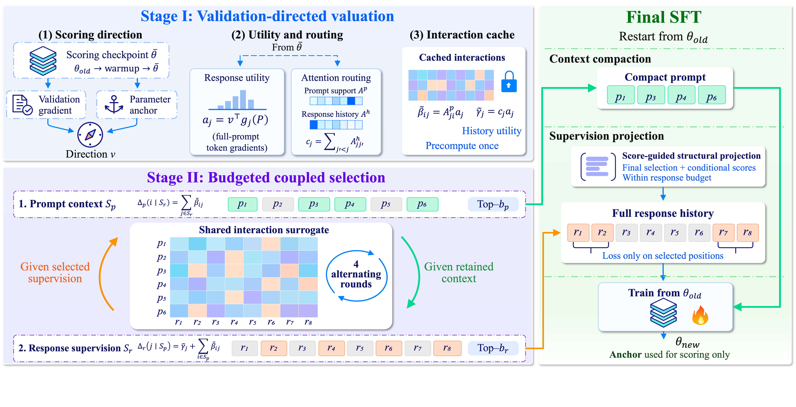

# 🌉 BRIDGE

**Anonymous Code Release**

<p align="left">
  
  
  
</p>

BRIDGE performs **validation-directed token scoring**, **fixed-interaction alternating selection**, and **Closure**, followed by instruction tuning.

Prompts are physically compacted in their original order, while responses remain complete during the forward pass. Only selected response positions receive direct supervision.

> **Note:** Final SFT starts from the original pretrained checkpoint, not the warmup checkpoint.

---

## 🔍 Overview

<p align="center">
  
</p>

<p align="center">
  <em>Overview of the BRIDGE framework.</em>
</p>

---

## ⚙️ Installation

**Requirements**

- Python 3.10+
- PyTorch and CUDA versions compatible with the available GPUs

Install the required dependencies:

```bash
python -m pip install -r requirements.txt
```

For **IFEval / IFBench** evaluation, install the additional dependencies:

```bash
python -m pip install -r requirements-eval.txt
```

The official verifier libraries and required licenses are provided under `external/`.

---

## 🚀 Quick Start

### 1. Prepare Resources

BRIDGE requires the original pretrained model weights, tokenizer, and datasets.

These resources are **not bundled** with the repository.

Configure the corresponding paths:

```bash
export BRIDGE_MODEL_PATH=/path/to/pretrained/Llama-3.2-3B
export BRIDGE_DATA_ROOT=/path/to/datasets
```

### 2. Run the Pipeline

Execute the reproduction script from the repository root:

```bash
python scripts/reproduce.py \
  --config configs/artifact/llama3b_metamath.yaml \
  --gpus 0 \
  --output-dir runs/llama3b_seed42 \
  --dry-run
```

> **Tip:** Remove `--dry-run` to execute the actual pipeline.

---

## 📊 Evaluation

BRIDGE provides two main script entry points:

| Script | Description |
|:---|:---|
| `scripts/reproduce.py` | Runs the complete pipeline or individual stages. |
| `scripts/evaluate.py` | Performs benchmark evaluation and result summarization. |

### 🔹 Pipeline Stages

Individual stages can be executed through `scripts/reproduce.py`.

Available stages:

| Stage | Description |
|:---|:---|
| `warmup` | Warmup training |
| `direction` | Direction computation |
| `scoring` | Token scoring |
| `select` | Data and token selection |
| `train` | Final instruction tuning |
| `eval` | Evaluation |
| `l2-direction` | L2-direction computation |

### 🔹 Evaluation Modes

The `scripts/evaluate.py` entry point supports the following modes:

| Mode | Description |
|:---|:---|
| `benchmarks` | Standard benchmark evaluation |
| `instructions` | Instruction-following evaluation (IFEval / IFBench) |
| `summary` | Evaluation result summarization |

---

<p align="center">
  <sub>BRIDGE · Anonymous Research Implementation</sub>
</p>